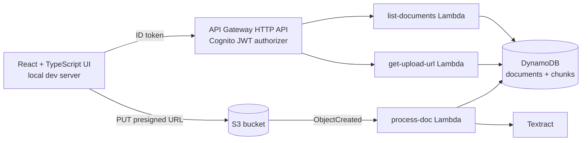

# PaperTrail AI

Upload personal documents (leases, bills, contracts), get structured summaries and
deadlines, and ask questions answered only from your own documents.

Built on AWS with CloudFormation, kept deliberately small and free-tier friendly. It is a
demo project, deployed, recorded, and torn down afterward.

## Architecture



## Status

| Feature | Status |
| --- | --- |
| Auth (Cognito user pool, JWT-protected HTTP API) | Done |
| Upload via presigned S3 URL, per-user key prefix | Done |
| S3-triggered processing Lambda, document status tracking | Done |
| Text extraction | In progress (Needs subscription) |
| Bedrock (Nova) summaries with key dates, obligations, costs | Planned |
| Chunking, Titan embeddings, cosine-similarity RAG with citations | Planned |
| EventBridge + SES deadline reminders | Planned |
| React UI (login, upload, document list, chat with sources panel) | Done |

## Project structure

```
infra/        CloudFormation template
backend/      Python Lambda functions (one folder each)
frontend/     React + TypeScript (Vite) UI
```

## Prerequisites

- An AWS account and an IAM user with CLI credentials (never commit keys)
- AWS CLI v2, Node.js 20.19+ or 22.12+, Python 3.12 runtime (for Lambda, deployed by AWS)

## Deploy

```bash
# one-time: a bucket for packaged Lambda code
aws s3 mb s3://papertrail-artifacts-<ACCOUNT_ID> --region us-east-1

aws cloudformation package \
  --template-file infra/template.yaml \
  --s3-bucket papertrail-artifacts-<ACCOUNT_ID> \
  --output-template-file infra/packaged.yaml

aws cloudformation deploy \
  --template-file infra/packaged.yaml \
  --stack-name papertrail \
  --capabilities CAPABILITY_IAM \
  --region us-east-1

aws cloudformation describe-stacks --stack-name papertrail \
  --query "Stacks[0].Outputs" --output table --region us-east-1
```

## Run the UI

```bash
cd frontend
cp .env.example .env   # fill in the stack outputs (API URL, client ID)
npm install
npm run dev
```

Open http://localhost:5173.

## Design notes

- Every document and chunk is keyed by the Cognito `sub`, and every Lambda reads the user ID
  from the verified JWT claims, never from the request body.
- Uploads go straight from the browser to S3 with a short-lived presigned URL.
- Retrieval is embedding search with cosine similarity over DynamoDB items. It is not a
  vector database.
- Lambda log groups have 3-day retention and are defined in the template, so they are
  deleted with the stack.
- Services that bill hourly (OpenSearch, Kendra, RDS/Aurora, NAT Gateway, Bedrock Knowledge
  Bases) are deliberately avoided.

## Teardown

1. Empty the documents bucket and the packaging bucket (CloudFormation cannot delete
   non-empty buckets).
2. `aws cloudformation delete-stack --stack-name papertrail --region us-east-1`
3. Delete the packaging bucket and confirm no log groups, Cognito pools, or DynamoDB tables remain.
4. Delete the IAM user's access keys.
5. Check Billing, then Free Tier and Credits, to confirm nothing is running.

